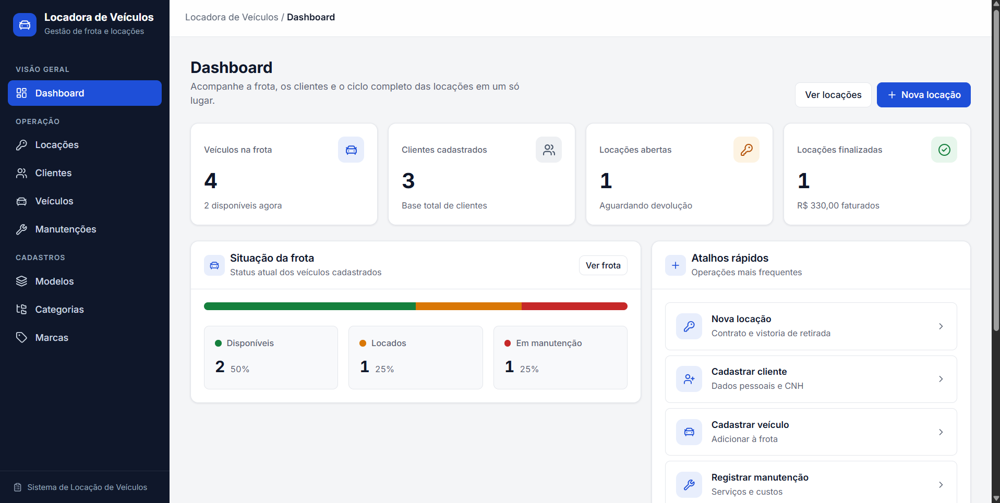
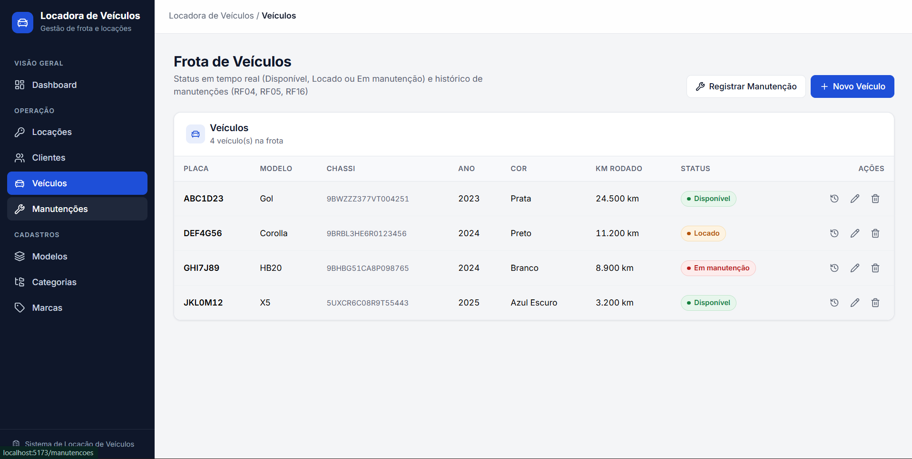
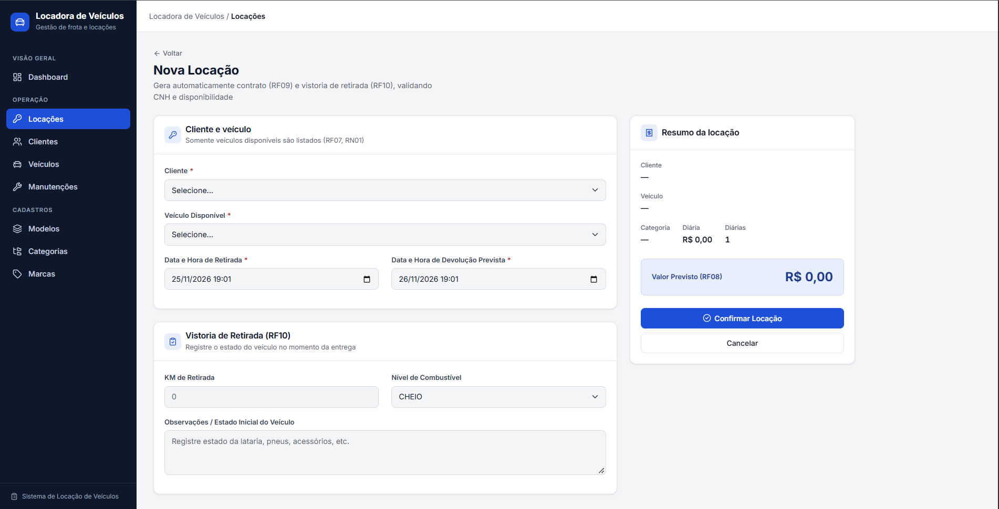
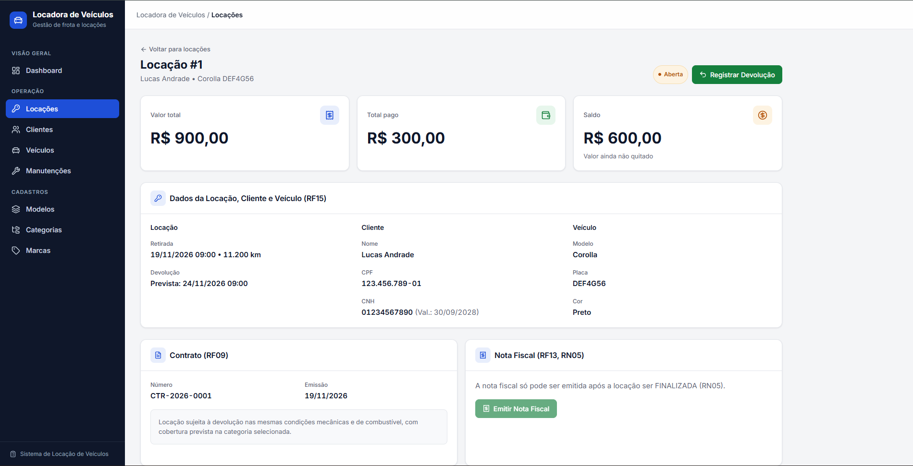
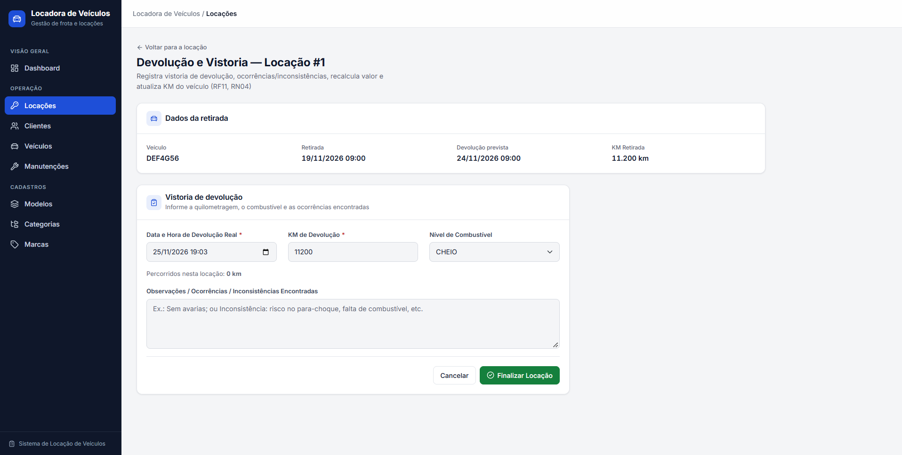

# Sistema de Locação de Veículos

**Aluno(a):** Salomão Santana Campos Ferreira

Aplicação web desenvolvida em **React**, **TypeScript** e **Bootstrap**, com API simulada em **JSON Server**. Ela cobre o controle da frota, dos clientes, das manutenções e todo o ciclo de uma locação: retirada, vistoria, contrato, pagamentos, devolução e nota fiscal.

## Funcionalidades

- **Cadastros:** marcas, categorias (ex.: Básico, Luxo, com o valor da diária), modelos, veículos, manutenções e clientes.
- **Frota:** a listagem de veículos mostra se cada um está **Disponível**, **Locado** ou **Em manutenção**.
- **Locação:** cálculo automático do valor previsto (nº de diárias × valor da diária da categoria), geração automática do contrato e da vistoria de retirada.
- **Devolução:** vistoria de devolução com km, combustível e as **ocorrências / inconsistências** encontradas no veículo; recálculo do valor total e atualização do km do veículo.
- **Pagamentos e nota fiscal:** vários pagamentos por locação e emissão de uma nota fiscal por locação finalizada.
- **Consultas:** lista de locações com filtro por status e por cliente, e tela de detalhes com cliente, veículo, contrato, vistorias, pagamentos e nota fiscal.

## Regras de negócio

| Regra | O que o sistema faz |
| ----- | ------------------- |
| RN01 | Veículo com locação **aberta** não pode ser locado novamente. |
| RN02 | A data de devolução prevista deve ser posterior à data de retirada. |
| RN03 | Cliente com CNH vencida não pode registrar locação. |
| RN04 | O km de devolução não pode ser menor que o km de retirada. |
| RN05 | A nota fiscal só é emitida para locação **Finalizada** (no máximo uma por locação). |
| RN06 | Registro com dependentes não pode ser excluído (ex.: marca com modelos); o sistema mostra uma mensagem. |

Outras regras: placa e chassi não se repetem; CPF e CNH não se repetem; só veículos **disponíveis** aparecem na nova locação.

> **Situação "Em manutenção":** como a manutenção não tem campo de status no modelo do banco, um veículo é considerado em manutenção quando possui uma manutenção com a **data de hoje ou futura**. No `db.json`, o HB20 (placa GHI7J89) tem uma manutenção agendada para 15/01/2027; ajuste a data se quiser testar essa situação em outro período.

## Tecnologias

- React + TypeScript + Vite
- React Router
- Axios
- Bootstrap
- JSON Server

## Como executar

É necessário ter o **Node.js 22.12 ou superior** (exigência do JSON Server 1.0).

```bash
# 1. instalar as dependências
npm install

# 2. subir a API simulada (porta 3001)
npm run server

# 3. em outro terminal, subir a aplicação
npm run dev
```

A API fica em `http://localhost:3001` e a aplicação em `http://localhost:5173`.

## Dados de teste

O `db.json` já vem com exemplos para testar as regras:

- **Locação aberta:** Corolla (DEF4G56) com o cliente Lucas Andrade. Ele não aparece na lista de Nova Locação (RN01 e RF07). A mensagem de bloqueio da RN01 só aparece se a locação for registrada em outra aba, depois de a lista já ter sido carregada.
- **Locação finalizada com nota fiscal** e **locação cancelada**, para testar os filtros por status.
- **Cliente com CNH vencida:** Carlos Eduardo. Tentar registrar uma locação para ele testa a **RN03**.
- **Veículo em manutenção:** HB20 (GHI7J89).
- **Exclusões bloqueadas (RN06):** tente excluir a marca Volkswagen ou o cliente Lucas Andrade.

## Estrutura do projeto

```
locadora-veiculos/
├── db.json          # dados da API (JSON Server)
├── package.json
├── tsconfig.json
├── README.md
└── src/
    ├── components/  # componentes reutilizáveis (Button, Input, Select, Table, Modal...)
    ├── models/      # interfaces, tipos e funções de cálculo das entidades
    ├── pages/       # telas, uma por funcionalidade
    ├── service/     # comunicação com a API e regras de negócio
    ├── App.tsx      # rotas
    └── main.tsx     # ponto de entrada
```

## Telas

<!-- Tire os prints das telas, salve em docs/ e confira se os nomes abaixo batem com os arquivos. -->

| Tela | Print |
| ---- | ----- |
| Início |  |
| Veículos (situação da frota) |  |
| Nova locação |  |
| Detalhes da locação |  |
| Devolução com vistoria |  |